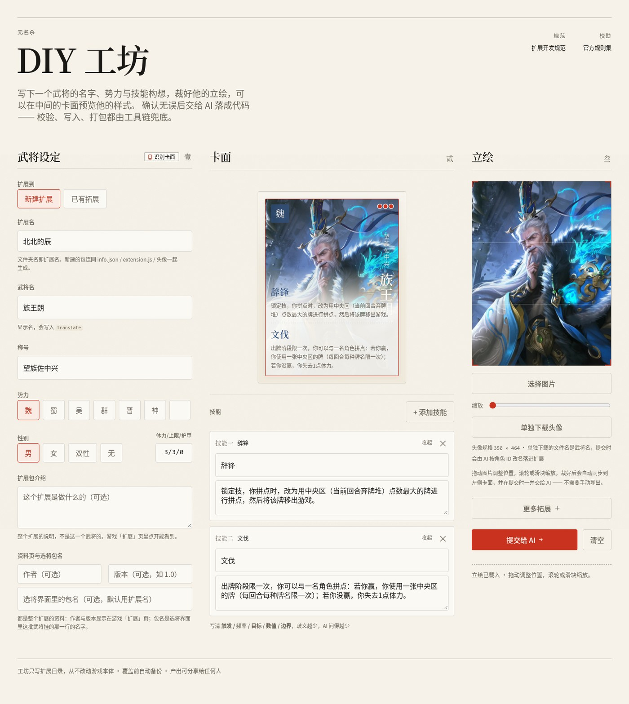

# noname-diy



<p align="center">
  <b>把中文技能描述转成可加载的无名杀武将扩展。</b><br/>
  网页填表 · 静态检查 · 一键打包 · 适用于任何可加载 skill 的 AI 助手
</p>

---

## 开始之前

本项目由 **AI 辅助创作**，虽经反复打磨，仍可能有不足之处 —— 欢迎各位批评指出，灰猫虚心接受。

对项目感兴趣的话，欢迎[加入群聊](#联系与支持)（QQ 群 1129840789），反馈问题、交流 DIY。

---

## 能力

| 能力         | 说明                                                                                         |
| ------------ | -------------------------------------------------------------------------------------------- |
| 新建武将     | 设定、技能、立绘一次生成                                                                     |
| 已有拓展     | 点方框选扩展（工作区 / 官方包 / 文件夹 / 压缩包）：挑一个武将就地改，或直接追加新武将；改前自动备份 |
| 设计审查     | 动手前核对数值、逻辑与时机可行性，一次问清                                                   |
| 技能实现     | 触发时机、锁定技、标记、私有存储、跨角色移牌                                                 |
| 台词与配音   | 台词写入 `translate`；配音支持 mp3 上传与试听                                                |
| 识别卡面     | 从卡面图识别武将名、称号、势力、体力、技能并回填；存疑项逐项确认                             |
| 多形态       | 换装 / 变身形态：自动裁至 350×464，可拖拽调整构图；填写「变身名」即生成技能变身形态          |
| 扩展资料     | 扩展包介绍（游戏「扩展」页可见）                                                             |
| 故障排查     | 武将不出现、技能不触发、加了没效果等静默失效问题                                             |
| 检查与打包   | 15 类静态检查，输出可直接导入游戏的压缩包                                                    |

输出约定：简短、面向非技术用户、武将信息优先。

## 设计要点

- **复用零件而非整套技能** —— 官方通常没有目标技能，但零件总有先例。若连可用写法都无法确定，
  属设计超出引擎能力，应回到需求层讨论，不生成看似可行、实际不可运行的实现。
- **静态检查是闸门，不是权威** —— 报错必修；无报错不等于正确。修改检查脚本后，
  须用正确样本与故意写坏的样本双向验证。

## 更新记录

- **2026-10-22** 工坊「加入已有」与「修改已有」合并为「已有拓展」：同一个方框里选扩展
  （工作区 / 官方包 / 文件夹 / 压缩包），选了武将就改它、不选就追加新武将；官方包改为
  只做模板，选包后直接填新扩展名；必填项缺失时滚动定位并红色高亮；修掉官方包状态残留
  导致的「填了扩展名仍提示没填」与「改选扩展后带着旧武将」两个问题
- **2026-10-19** 工坊「多形态」区重构：国战移至第三列；空态改为单行提示（原占位约 250px）；
  多张时限高两排、超出内部滚动；「调整」由滑块改为居中弹窗，支持拖拽与滚轮缩放
- **2026-10-19** 卡面识别与扩展包解耦：仅依赖图片，不再要求先选扩展；支持拖拽上传；
  仅上传立绘亦可识别
- **2026-10-18** 补充三处静默失效项：`forResult()` 不可解构、事件 `content` 必须 `async`、
  `gaintag` 需 `eternal_` 前缀；`ai` 字段改为模板骨架 + 自动检查双重保障；新增设计审查清单
- **2026-10-18** 静态检查 12 → 15 类；技能模板补主动技骨架；「修改已有」支持直接选取工作区扩展
- **2026-10-17** 首页截图重制；游戏包内扩展支持复制为工作区副本后修改（不写游戏本体）
- **2026-10-16** 「选择扩展包」新增官方包来源（作模板）；界面字体与对比度整改

---

## 安装

将 `noname-diy-skill.zip` 解压后的 `noname-diy/` 放入 AI 助手的 skill 目录：

| AI 助手          | 路径                                                          |
| ---------------- | ------------------------------------------------------------- |
| Claude Code      | `~/.claude/skills/<名字>/` 或 `<项目>/.claude/skills/<名字>/` |
| DeepSeek Harness | `~/.dsh/skills/<名字>/` 或 `<项目>/.dsh/skills/<名字>/`       |
| Codex / 其他     | 按各自约定，通常为 `<配置目录>/skills/<名字>/`                |

支持「从仓库安装」的助手，可直接提供仓库地址安装。

### 更新

使用包内脚本，避免逐文件替换：

```sh
python3 scripts/update-skill.py <新版本.zip>
```

覆盖包内全部文件，不触碰 skill 目录之外的任何内容，并合并 `references/version-notes/` 的
「本机增量」小节 —— 本机积累的引擎经验不因换版本丢失。

| 范围     | 内容                                                                  | 处理       |
| -------- | --------------------------------------------------------------------- | ---------- |
| 随包更新 | `SKILL.md`、`scripts/`、`references/`、`workshop/`、`assets/`         | 上述命令   |
| 不受影响 | 工作区（`扩展源码/`、`.diy-workshop/`、`成品/`），位于 skill 目录之外 | 无需操作   |
| 自动保留 | `references/version-notes/*.md` 的「本机增量」                        | 更新时合并 |

**注意**：工作区不可置于 skill 目录内，否则换版本时会被一并覆盖。
若同时升级游戏版本，`references/version-notes/` 的基线部分需复核（结论随游戏版本变化）。

不支持 skill 机制的助手：将 `SKILL.md` 作为对话上下文，按需附上 `references/` 中对应文档；
脚本为独立 Node / Python 程序，可正常调用。

## 依赖

| 软件           | 用途                       | 获取                                                                                                 |
| -------------- | -------------------------- | ---------------------------------------------------------------------------------------------------- |
| Node.js 18+    | 工坊服务、静态检查         | [nodejs.org](https://nodejs.org) LTS 版                                                              |
| Python 3.8+    | 打包与资源处理             | [python.org/downloads](https://www.python.org/downloads/)（Windows 需勾选 `Add python.exe to PATH`） |
| 无名杀（可选） | 核对技能写法；运行自制扩展 | 需已安装，未提供时自动搜索安装位置                                                                   |

前两项缺失时，脚本会明确报出缺什么、如何安装。

无名杀可省略，仅少三项依赖源码的检查（时机名、id 撞名、API 是否存在）。已安装者提供目录即可，
或由脚本自行搜索 —— 搜索目标是已安装的游戏，非要求另下源码。

---

## 怎么用

安装后首次运行会启动网页工坊并给出访问地址。也可直接在对话中提出需求：

- 「帮我做个武将：灰猫，群势力，4 血，技能——出牌阶段你可以弃一张牌，然后摸一张」
- 「把这段描述做成无名杀武将：锁定技，……」
- 「这个武将在游戏里技能没反应，帮我看下」
- 「把 `扩展源码/我的扩展` 打包成能导入游戏的压缩包」

### 网页工坊

填表 + 裁剪立绘（350×464）+ 实时预览卡面。点击「提交给 AI」后在对话中确认一次，AI 接手实现；
有歧义会就地问。

图片支持拖拽上传。选择卡面图后可点「识别卡面」自动回填 —— 识别只依赖图片，
与目标扩展包无关，无需预先选择。

| 模式     | 用途                                                                                             |
| -------- | ------------------------------------------------------------------------------------------------ |
| 新建扩展 | 从零创建武将                                                                                     |
| 已有拓展 | 点方框选扩展（工作区 / 官方包 / 文件夹 / 压缩包）：选一个已有武将就地改，或直接追加新武将。官方包只能当模板，产物是新建的扩展 |

端口与文件位置见 [`workshop/README.md`](workshop/README.md)。未提供立绘亦可交付，AI 会提示补图。

---

## 脚本

```bash
# 静态检查（15 类）：文件完整性、写法、命名一致性、技能字段、时机名、
#   台词键、id 撞名、API 存在性、视为技的 AI 响应标记、ai 缺失、gaintag 前缀等
node scripts/check-extension.mjs <扩展目录> [引擎源码根]
#   退出码：0 通过 · 1 有错误 · 2 脚本自身失败

# 打包（压缩包根目录直接为 extension.js，游戏方可识别）
python3 scripts/pack-extension.py <扩展目录> [输出.zip]

# 解包并定位扩展根（压缩包常多套一至两层目录）
python3 scripts/unpack-extension.py <压缩包> [输出目录]
```

> **Windows 命令名差异**：官方安装器仅提供 `python.exe` / `py.exe`，无 `python3.exe`，
> 上述命令改用 `python scripts/...` 或 `py scripts/...`。工坊服务端会自动探测，
> 亦可用环境变量 `DIY_PYTHON` 指定。

---

## 使用限制与注意事项

- **静态检查的边界**：只能验证写法、命名一致性与 API 存在性；调用顺序等运行期问题无法覆盖。
  台词项仅校验键名与序号，不推断归属 —— 皮肤与多形态会使归属复杂化，强行推断必生误报。
- **扩展重名会覆盖他人扩展**：新建前查重，同名时中止并询问。
- **仅生成独立扩展，不改动游戏本体**（游戏目录内文件一律不动）。
- **技能名与描述保持原样**：发现错别字或表述矛盾时指出并询问，不做润色。
- **连续提交会覆盖前一份**（工坊无队列）。落盘文件带 `processed` 标记，AI 完成后置为 `true`，
  可据此判断是否已处理，但被覆盖的内容无法找回 —— 需改需求时，待 AI 确认完成后再提交。
- **工坊可读常规写法的扩展包与游戏自带官方包**（后者作模板）；动态生成或特殊注册的写法无法解析，
  会提示手动填写，不做猜测。
- **平台**：脚本仅依赖 Node / Python 标准库，Windows / Linux / macOS 均可运行。
- `references/version-notes/` 分「基线」与「本机增量」两段：前者随游戏版本更新，
  后者由 `scripts/update-skill.py` 在更新时合并保留。

## 许可证

**GPL-3.0** —— 与无名杀本体一致。`references/` 实质引用了其源码结构与逻辑，按最保守的解释属于衍生作品。

## 作者

OTH-C3

## 联系与支持

<table>
  <tr>
    <td align="center" width="50%">
      <br/>
      <sub>QQ 群 <b>1129840789</b> </sub>
    </td>
    <td align="center" width="50%">
      <a href="https://ifdian.net/a/othc3"></a><br/>
      <sub><a href="https://ifdian.net/a/othc3">爱发电 · 请我喝杯咖啡</a></sub>
    </td>
  </tr>
</table>

<details>
<summary><b>其他赞助方式</b>（微信 / 支付宝）· </summary>

<br/>

<table>
  <tr>
    <td align="center" width="50%">
      <br/>
      <sub>微信支付</sub>
    </td>
    <td align="center" width="50%">
      <br/>
      <sub>支付宝</sub>
    </td>
  </tr>
</table>

</details>
